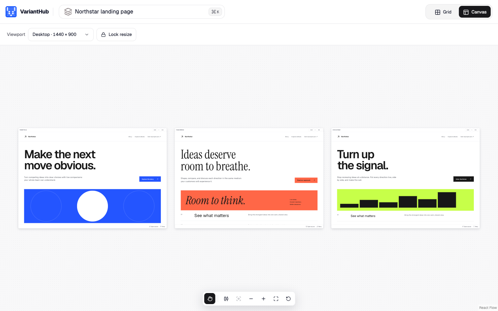

# VariantHub

VariantHub is a local workspace for comparing alternative versions of an interface side by side. You register the variants that already live in your project (React components, HTML pages or running URLs) and VariantHub shows them live in a grid, on a canvas of resizable artboards, or one at a time in a full-size preview. Everything runs on your machine against your own code.



You can arrange artboards at Mobile, Tablet, Desktop or Wide sizes, star the variants you want to keep, and step through a selection with the keyboard. The arrangement is saved in your repository, so committing it shares the same view with the rest of the team. A workspace shows up to twenty variants at a time.

VariantHub is free and open source under the [MIT License](LICENSE). GitHub is the only place it is distributed; nothing is published to a package registry.

## Requirements

- Node.js 22 or newer
- Git (optional), for the dates shown on each variant
- A desktop browser

## Install

```sh
git clone https://github.com/mattiamichini-design/varianthub.git
cd varianthub
npm ci
npm run build:packages
```

`build:packages` builds the React viewer and the local runner. Your project does not need a `package.json` or any VariantHub dependency.

## Run it on a project

The runner works with HTML pages and URLs. Point it at the root of your project:

```sh
node /path/to/varianthub/packages/runner/src/cli.mjs init --root /path/to/your-project
node /path/to/varianthub/packages/runner/src/cli.mjs start --root /path/to/your-project
```

Open http://127.0.0.1:4310. Stop the runner with Ctrl+C.

`init` writes `varianthub.config.json` in the project and never overwrites an existing one. Add `--examples` to also copy two editable HTML pages into `varianthub-examples/` and register them together with a live three.js page (that one needs an internet connection). `start` accepts `--port` to use a port other than 4310. The runner reads the configuration when it starts, so restart it after editing the file; HTML, CSS and JavaScript sources are read on every request.

## Configuration

```json
{
  "version": 1,
  "projectId": "my-project",
  "roots": ["pages"],
  "viewportPresets": { "mobile": { "width": 375, "height": 812 } },
  "explorations": [
    {
      "key": "landing",
      "name": "Landing page",
      "kind": "page",
      "path": "pages",
      "sourcePaths": ["pages/index.html", "pages/style.css"],
      "variants": [
        { "id": "editorial", "name": "Editorial", "source": { "type": "html", "entry": "pages/index.html" } },
        { "id": "staging", "name": "Staging build", "source": { "type": "url", "url": "http://localhost:5173/" } }
      ]
    }
  ]
}
```

- `projectId` is a stable identifier. The browser keeps favorites, visits and camera position per project ID.
- `roots` lists the folders the runner may serve files from. Paths outside them, dotfiles and symlinks that leave them are refused.
- An exploration groups the alternatives of one subject. Its `key` and each variant `id` must stay stable, because saved layouts refer to them. `kind` is `component` (the default) or `page`.
- An `html` source points at an entry file inside a root; relative CSS, JavaScript and images load next to it. A `url` source must already be served and must allow embedding in an iframe.
- `sourcePaths` lists the files whose Git history provides the variant dates. Without Git, dates show as unknown.
- `viewportPresets` overrides the default sizes: Mobile 390×844, Tablet 768×1024, Desktop 1440×900 and Wide 1920×1080.

Shared layouts are saved in `.varianthub/layouts/<exploration>.json` inside the project. Commit them to share an arrangement. If someone else changes a layout while you have it open, VariantHub reports a conflict and asks you to reload before saving.

Variants are your own project code. They run in same-origin iframes, which are not a sandbox for untrusted code.

## React projects

The runner does not compile React. For React components, keep your existing app as the host and mount the viewer from `packages/core` (`varianthub-core`) in one of its routes. The host registers the components and provides the routes that render a single variant. Layout persistence comes from `varianthub/server` in `packages/runner`. [packages/core/README.md](packages/core/README.md) describes the integration, and `tests/consumers/react` is a minimal working host.

## Coding agents

`packages/runner/skills/` contains two agent skills in the `SKILL.md` format:

- `varianthub-builder` sets up or updates VariantHub in a project, either with the runner or in a React host.
- `varianthub` creates and registers new variants, then checks that they open correctly.

Copy the skill folders into the project skill directory of your agent, for example `.claude/skills/` for Claude Code or `.agents/skills/` for Codex. Any agent that reads `SKILL.md` files can use them. Copied skills do not update with the checkout, so copy them again after you pull. Agents are optional; the CLI and the configuration file work without them.

## Update

```sh
cd /path/to/varianthub
git pull
npm ci
npm run build:packages
```

Your project's configuration and saved layouts are left as they are. To uninstall, stop the runner and delete the checkout.

## Repository layout

- `packages/runner`: the local runner (`varianthub`), its CLI, the layout storage and the agent skills.
- `packages/core`: the React viewer (`varianthub-core`) and its CSS theme.
- `src`: the Next.js website, with the landing page at `/` and a sample workspace at `/playground`.
- `tests`: browser tests for the website and a minimal React consumer.
- `docs/adr`: architecture decisions.

## Development

```sh
npm run dev               # website on http://localhost:3000
npm run lint
npm run typecheck
npm run test:core         # packages/core unit tests
npm run test:runner       # packages/runner tests
npm run test:e2e          # Playwright suite against a dev server on port 3100
npm run build             # production build of the website
npm run verify:packages   # pack both packages and test them in temporary projects
```

In development the site also serves a maintainer workspace at `/workspace`, which renders the demo catalog and writes layouts to `.varianthub/`. Production builds return 404 for the maintainer routes unless `VARIANTHUB_MAINTAINER_ROUTES=1` is set when building and starting the site. [CONTRIBUTING.md](CONTRIBUTING.md) lists the checks to run before a pull request.

`npm run capture:marketing` refreshes the landing page screenshots from a site running on port 3000. `npm run audit:history` scans the local Git history for common secret patterns.

## Deploying the website

The website is a standard Next.js app and deploys to Vercel without extra configuration. Set `NEXT_PUBLIC_SITE_URL` to the public origin, for example `https://varianthub.example`. Canonical links, social cards, `robots.txt` and `sitemap.xml` use it. On Vercel the production domain is used when the variable is missing.

## License

[MIT](LICENSE)
